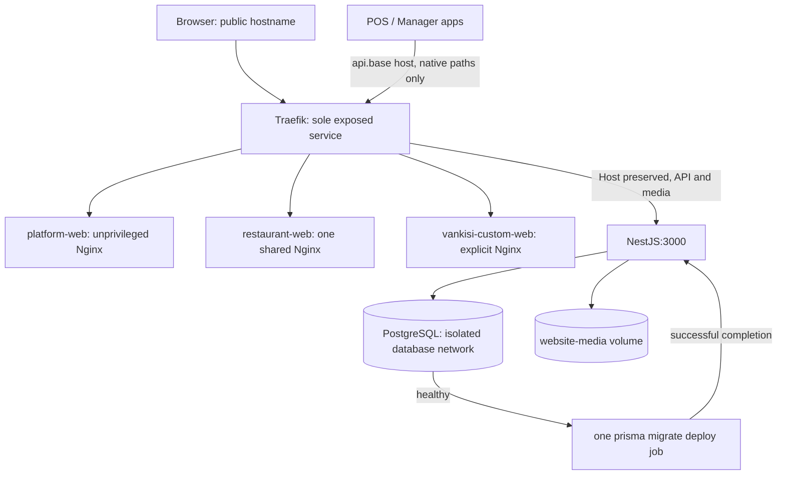

# Vynic deployment and local production workflow

This is the canonical container runbook. SAAS and CUSTOM use the **same NestJS
backend, PostgreSQL schemas, tenant resolution and website capabilities**.
WebsiteMode chooses a renderer. It does not select a different data backend.
Nothing here reads, imports or migrates the live `vankisi_database`.

## Quick start (macOS / Docker Desktop)

Run from the repository root. Docker Desktop must be running; port 80 must be free.
The wrapper finds Docker Desktop's CLI even when it is absent from PATH.

```sh
python3 scripts/docker-init.py  # creates .env.docker with six independent secrets; refuses overwrite
./scripts/docker.sh start      # production builds, migrations, readiness checks
./scripts/docker.sh seed       # explicit, idempotent sample creation
./scripts/docker.sh admin --email you@example.com --name "Your Name"
```

The last command prompts for a password without echo using the existing protected
admin bootstrap. It refuses to reset an existing account. A Platform Admin is
not Staff, a customer owner, or a website SUPER_ADMIN. Subsequent administrators
are managed in Platform. Seed preserves existing sample edits and does not reset
accounts or silently run at startup.

Alternatively, `cp .env.docker.example .env.docker`, fill its six blank secrets
independently with `openssl rand -hex 32`, then use:

```sh
export PATH="/Applications/Docker.app/Contents/Resources/bin:$PATH" # macOS if needed
# Exact underlying start command:
docker compose --env-file .env.docker -f compose.yaml -f compose.local.yaml up -d --build --wait
```

| URL | Renderer / purpose |
| --- | --- |
| <http://vynic.localhost> | Vynic public site and customer dashboard |
| <http://admin.vynic.localhost> | Platform Admin, isolated browser origin |
| <http://tabla.vynic.localhost> | Sample SAAS Venue |
| <http://vankisi.vynic.localhost> | Sample CUSTOM Venue, `vankisi-web` |
| <http://preview.vynic.localhost> | Generic renderer for signed owner previews; no default Venue |
| <http://api.vynic.localhost> | **Native POS/Manager API only** (never a website); see [Native POS / Manager ingress](#native-pos--manager-ingress) |

An unregistered restaurant hostname can load the generic static shell, but its
API returns 404 and the renderer shows unavailable. It never falls back to Vankisi.
Normal browsing requires no `:3000`, `:5173`, `:5174`, or `:5175`.

## Previous runtime and deployment audit

The previous local workflow ran Nest on port 3000 and Vite on 5173 (Platform),
5175 (SAAS), and 5174 (Vankisi). Vite's website proxies preserved Host; Platform
proxied `/platform`, `/customer` and media. `npm run start:prod` runs a Prisma
migration hook before every process start; the container intentionally executes
`node dist/src/main.js` directly. `npm run serve` used PM2. Vankisi's Vercel config
provided only an SPA rewrite, not a shared API deployment. There was no Compose
or Dockerfile foundation in these apps.

Audited entry points: `src/main.ts`, website tenancy/Host normalization and
same-origin policy, WebsiteAuth/CryptoService, Platform and Customer auth,
`site-origins.ts`, all three Vite configs and frontend API clients, Prisma schema
and migration history, bootstrap/admin scripts, website media storage,
payment encryption/import, CUSTOM binding/runtime checks, onboarding release
settings and Firebase initialization. No existing `.env` secrets were read or
copied into this deployment. The pre-existing `dev-origins.ts` and its test changes
were left out of the deployment commits.

## Architecture and lifecycle



Local Compose project is `vynic-local-prod`. `compose.yaml` defines images and
shared services; `compose.local.yaml` adds PostgreSQL, fixed isolated DB URLs and
loopback HTTP. Production uses `compose.production.yaml` instead of the local
file. Dependencies gate migrations on PostgreSQL health, backend on migration
success, and ingress on backend and all frontend HTTP health. Frontends may start
while migrations run but are not publicly reachable until ingress starts.

Images use Node 22 build stages and checked-in npm lockfiles (`npm ci`). Backend
runtime contains compiled JS, production dependencies and generated Prisma client;
Prisma CLI/schema/migrations remain for the single deployment job. It runs as
`node`, not root. Frontends contain only built output and unprivileged Nginx.
Vankisi explicitly builds with `VITE_COMING_SOON=false` for this launched fixture.
Build contexts exclude environment files, secrets, caches and local dependencies.

## Traefik routes and trust

Traefik v3 file provider was chosen over Docker labels so it needs **no Docker
socket**. `deploy/traefik/routes.yml` uses deployment environment templating and
explicit router priorities. See [Traefik file provider](https://doc.traefik.io/traefik/v3.3/providers/file/)
and [Compose startup conditions](https://docs.docker.com/compose/how-tos/startup-order/).

| Priority | Match | Destination |
| --- | --- | --- |
| 500 | `api.<base>` + `/edge/`, `/mobile/`, `/auth/`, `/sync/`, `/socket.io/`, `/healthz` | backend (native POS/Manager API) |
| 500 | opt-in LAN listener `:8088`, same native paths, no Host rule | backend (`start-lan` only) |
| 450 | any other path on `api.<base>` (and on the LAN listener) | backend, path rewritten to an unrouted path, so Nest answers JSON 404 |
| 400 | applicable hosts, `/api` or `/api/*`, `/media/website-logos/*` | backend, path unchanged |
| 400 | admin host, `/platform` or `/platform/*` | backend |
| 400 | public base host, `/customer` or `/customer/*` | backend |
| 300 | exact base and admin hosts | platform-web |
| 200 | exact `CUSTOM_HOST` | vankisi-custom-web |
| 100 | one label under `SAAS_WEBSITE_BASE_DOMAIN` | restaurant-web |

The shared wildcard serves any number of SAAS customers. A hostname contains no
SAAS/CUSTOM marker. A deployment operator adds an explicit CUSTOM router/service
when provisioning a new bespoke renderer, keeping priority 200 and the same API
route. Add that domain to the API router when it is outside the base wildcard.
DNS, static routing and WebsiteMode must be coordinated by that operator; this
foundation does not dynamically deploy a frontend when a database mode changes.

`passHostHeader=true` retains the public authority. Nest tenancy reads `Host`;
`TRUST_PROXY_HOST=false` means arbitrary `X-Forwarded-Host` cannot select a Venue.
Traefik does not enable insecure forwarded-header trust. Nest trusts client-IP
forwarding only from ingress `172.30.89.2`, not arbitrary peers. Automatic app IPs
use `172.30.89.128/25` within the dedicated `/24` to reserve that address. If this
subnet conflicts with a VPN/network, change IPAM, `TRUST_PROXY_IPS` and the fixed
local-check target together, then recreate only these networks (keep volumes).

The app network allows backend outbound provider calls. The DB network is
`internal`; PostgreSQL joins only it and publishes no host port. The Docker
engine operator remains a trusted administrator of container environments and
volumes. No public dashboard or Docker socket is exposed.

Same-origin browser calls use `/api/...`; no tenant ID is added by a frontend.
Platform retains `/platform/...` on its admin origin and Customer `/customer/...`
on the public origin. Platform/Customer sessions are bearer tokens in origin-scoped
sessionStorage, not WebsiteUser cookies. Public-host admin requests never route
to the Platform API. The UI also selects Admin only on its explicit admin hosts.

## Environment inventory

Runtime values come from Compose's `environment` mapping, **not** an application
`.env` mount. `.env.docker` / `.env.production` are Compose interpolation inputs;
adding a new optional backend setting there alone does not inject it. Add its
explicit `environment` entry when enabling that capability. Never dump resolved
`docker compose config` into tickets: it contains secrets. Use `config --quiet`.

Each table row specifies reader, requirement, examples/production expectation and
secrecy. `G` below means an independently generated `openssl rand -hex 32` value.

| Variable | Reader / requirement | Local / production expectation | Secret / generation |
| --- | --- | --- | --- |
| `DATABASE_URL` | Prisma/backend/migrate; required | Local override forces `postgres:5432/vynic_local_prod`; production uses managed PostgreSQL URL with `sslmode=require` and both `pos`/`website` schemas | Yes, provision DB credentials; URL-encode password |
| `NODE_ENV` | Nest/auth/tenancy; production in containers | `production` in both environments; never lower to development to permit HTTP | No; fixed Compose value |
| `PORT` | Nest listener; optional default 3000 | 3000 internally in both | No |
| `JWT_SECRET` | Manager, Website, Customer JWTs; required | G in both; production startup requires >=32 chars | Yes; G |
| `JWT_REFRESH_SECRET` | WebsiteAuth; required in production | Independent G | Yes; G |
| `COOKIE_ENCRYPTION_KEY` | Website AES-GCM and staff PIN vault; required | Independent G; code uses scrypt to derive 32-byte key from the string | Yes; G; retain with backups |
| `PLATFORM_JWT_SECRET` | PlatformAuth; optional in code, required by this Compose foundation | Independent G; otherwise code uses JWT_SECRET with separate issuer/audience/principal | Yes; G |
| `PAYMENT_INTEGRATION_MASTER_KEY` | Venue payment AES-256-GCM; optional overall, required by this Compose foundation | **Exactly 64 hex characters** (32 random bytes); absent integration remains unavailable | Yes; G; retain with encrypted payment backups |
| `FRONTEND_URL` | HTTP/Socket.IO CORS, legacy import fallback; optional code, required Compose | `http://vynic.localhost` / `https://vynic.ge` | No |
| `API_URL` | BOG callback origin; optional code, required Compose | `http://vynic.localhost` / `https://vynic.ge`; append callback path handled by code | No; local callback is not reachable by BOG |
| `ALLOWED_ORIGINS` | HTTP and Socket.IO CORS; optional CSV | Public and admin exact origins; production HTTPS only, no `*` | No |
| `TRUST_PROXY_HOST` | Tenant/Core/CORS authority; optional | `false` in both; Host-preserving proxy | No; do not enable globally |
| `TRUST_PROXY_IPS` | Express client IP; optional, added here | Exact ingress IP `172.30.89.2`; no CIDR or boolean wildcard | No; match actual trusted ingress |
| `VYNIC_LOCAL_DOCKER` | Startup, Website cookies and CUSTOM checker; optional, added here | `true` only in local override; production fixed `false` | No; startup requires isolated Docker DB, local base domain and local HTTP public origin |
| `SAAS_WEBSITE_BASE_DOMAIN` | SaaS assignment/publication; required to publish | `vynic.localhost` / `vynic.ge`; changing this does not remap existing VenueDomains | No |
| `SAAS_WEBSITE_PREVIEW_ORIGIN` | Customer signed preview; optional | `http://preview.vynic.localhost` / `https://preview.vynic.ge` | No; unset disables preview link |
| `WEBSITE_MEDIA_DIR` | media service; required in production startup | `/var/lib/vynic/media`, mounted persistent volume | No |
| `DEVICE_API_BASE_URL` | enrollment response; optional | `http://api.vynic.localhost` (local override default; empty in `start-lan`) / `https://api.vynic.ge` | No; HTTPS required in production |
| `POS_SYNC_API_KEY` | legacy POS guard; optional, not injected here | Unset disables legacy auth in production; enrolled Device credentials still work | Yes; G if legacy fleet compatibility is intentionally enabled |
| `MANAGER_LEGACY_LOGIN_UNTIL` | ManagerAuth compatibility; optional | Unset; explicit ISO deadline only during approved legacy rollout | No |
| `WEBSITE_DEV_HOST` | dev tenant fallback; optional | Unset and ignored in production; e.g. `vankisi.localhost` in direct dev | No |
| `CUSTOM_WEBSITE_LOCAL_FRONTENDS` | direct-dev CUSTOM checks; optional | `vankisi-web=5174` in direct development only; absent/ignored in production containers | No |
| `CUSTOM_WEBSITE_DEV_PORT` | stale-setting diagnostic only | Deprecated/ignored; remove from direct-dev env | No |
| `SUPER_ADMIN_PHONE` | legacy Website bootstrap; optional | Unset here; do not confuse with Platform Admin | Personal/account data; operator-supplied |
| `SUPER_ADMIN_EMAIL` | legacy Website bootstrap; optional | Unset; fallback is `admin@example.com` only when phone/password configured | Personal/account data |
| `SUPER_ADMIN_PASSWORD` | legacy Website bootstrap; optional | Unset; configuring it resets that legacy website account at boot | Yes; operator-generated, not external provider |
| `PLATFORM_ADMIN_PASSWORD` | existing admin CLI only; optional | Prefer interactive prompt; for automation pass through ephemeral environment | Yes; password-manager-generated, minimum 8 chars |
| `EDGE_FOUNDATION_SIGNING_KEY_PEM` | optional Edge signed foundation bundles | Unset until shipping Edge bundles; provision PEM Ed25519 key | Yes; `openssl genpkey -algorithm ED25519`; mount/inject securely |
| `GOOGLE_APPLICATION_CREDENTIALS` | Firebase Admin SDK ADC; optional | Unset locally; read-only mounted service-account JSON path if push is enabled | File secret from Google; not fabricated by Vynic |
| `BOG_CLIENT_ID` | explicit legacy import script only | Unset here; real per-Venue provider identity during deliberate import | Provider-supplied; sensitive |
| `BOG_CLIENT_SECRET` | explicit legacy import script only | Unset here; never required for container startup | Yes; obtained from Bank of Georgia |
| `BOG_RETURN_ORIGIN` | explicit legacy import script; optional fallback FRONTEND_URL | Venue website's approved HTTPS origin | No; code validates it |
| `VITE_API_BASE_URL` | Platform build; optional | Empty, preserving same-origin API paths | No; Vite values are public build-time data |
| `VITE_API_URL` | Vankisi build; optional | `/api` for same origin; no Venue ID | No; public build-time data |
| `VITE_COMING_SOON` | Vankisi build; optional | `false` explicitly in this build; omitted production build otherwise defaults to coming-soon | No |
| `VYNIC_WEBSITE_API` | SAAS/CUSTOM Vite dev proxy only | Direct-dev `http://127.0.0.1:3000`; not read by static runtime | No |
| `PORT` (Vankisi Vite) | direct-dev Vite server only | Default 5174; unrelated to static Nginx port 8080 | No |

Compose/image-only inputs (these are not invented Nest settings):

| Variable | Reader / requirement | Local / production | Secret / generation |
| --- | --- | --- | --- |
| `POSTGRES_PASSWORD` | local PostgreSQL image / local DB URL; local required | G, hexadecimal avoids URL quoting; not used in managed-DB production | Yes; G |
| `POSTGRES_USER`, `POSTGRES_DB` | official local PostgreSQL image; fixed in local YAML | `vynic`, `vynic_local_prod`; not environment knobs | Username no; DB name no |
| `CUSTOM_HOST` | Compose → Traefik file provider; required | `vankisi.vynic.localhost` / `vankisi.vynic.ge` | No; operator deployment mapping |
| `BASE_DOMAIN` | Traefik template; injected from SAAS_WEBSITE_BASE_DOMAIN | Same suffix as backend | No |
| `PROXY_TLS` | Traefik template; default false, production override true | HTTP locally / HTTPS router in production | No |
| `NATIVE_LAN` | Traefik template; fixed `false`, `compose.lan.yaml` sets `true` | Never set by hand; enables the LAN routers | No |
| `NATIVE_LAN_BIND` | `compose.lan.yaml` port binding; required for LAN mode | One private LAN IPv4 of this Mac, set by `start-lan` (never `0.0.0.0`) | No; do not commit |
| `NATIVE_LAN_PORT` | `compose.lan.yaml` host port; optional | `8088` | No |
| `IMAGE_PREFIX` | Compose image names; optional | `vynic` / private registry namespace | No; registry credentials use Docker login/CI secrets separately |
| `IMAGE_TAG` | Compose image names; optional | `local` / immutable release tag (prefer digest pinning in release manifests) | No |
| `APP` | shared frontend Dockerfile build argument; fixed per service | Three existing app directory names | No |

Inventory scope is deployable source, Prisma, Vite, admin/import entrypoints and
runtime release settings. Disposable test harnesses have their own guarded
`*_TEST_DATABASE_URL`, `TENANT_INTEGRATION_DATABASE_URL`, browser executable and
QA-output settings; they are **not** deployment inputs and are not injected.
Release/download URLs are persisted onboarding settings edited in Platform,
not `RELEASE_URL` environment variables. No such unused variable was introduced.

Production startup now rejects missing required auth/media config, short or
placeholder secrets, malformed payment keys, wildcard CORS, broad IP trust and
HTTP public origins outside explicit local mode. Payments, FCM and Edge signing
are not made globally mandatory. No BOG credentials means payment/paid-booking
capabilities remain unavailable. Existing app dev scripts remain unchanged.

## Cookies, localhost and optional TLS

Production WebsiteUser cookies are host-only, HttpOnly (except CSRF), SameSite
Strict and Secure. Explicit local Docker mode permits HTTP cookies **only** for
`vynic.localhost` and its single-label subdomains; it does not turn production
tenancy into development mode. Public-domain cookies remain Secure even when the
local flag is enabled. Startup refuses the flag with a non-isolated DB/domain.
CSRF double-submit behavior and encryption are unchanged. There is no wildcard
cookie Domain joining customers or admin sessions.

The CUSTOM on-demand checker displays `http://vankisi.vynic.localhost/` and connects
to the **fixed** trusted proxy at `172.30.89.2:8080`, preserving that registered
Host. It accepts only this local namespace under the explicit flag; it cannot be
used to probe arbitrary private hosts. Public checks retain public-address DNS
validation, address pinning, no redirects, bounded response size and timeouts.
Direct Vite checks retain their separate site-key→port mapping outside production.

Nested `.localhost` names resolved without `/etc/hosts` edits in macOS Brave
(Chromium). Google Chrome was not installed/available to the browser tool; exact
Chrome qualification remains to be repeated there. Some command-line resolvers
use system DNS and do not implement `.localhost`: use `curl --resolve
vankisi.vynic.localhost:80:127.0.0.1 http://vankisi.vynic.localhost/api/website/venue`.
Do not change normal URLs to ports or import live data to work around resolution.

HTTP is sufficient for this local workflow after the narrowly scoped cookie
adjustment. Optional trusted local TLS can reuse mkcert with a certificate for
`vynic.localhost` and `*.vynic.localhost`, mounted to the same certificate paths
as production. Use a separate local TLS override exposing 443, TLS routers,
HTTPS origins and Secure cookies (the supplied local HTTP guard intentionally
rejects an HTTPS origin with its HTTP mode). This is evaluated, not shipped as a
second supported mode; there is no automatic trust-store mutation or certificate
warning bypass. Production is HTTPS-only.

## Native POS / Manager ingress

POS and Manager are native Flutter apps, not browsers. Their backend calls use
a **dedicated native API origin**, separate from every website host:

| Where the app runs | API origin (what you type / build in) |
| --- | --- |
| Same Mac as Docker | `http://api.vynic.localhost` |
| Windows/Parallels VM or another device on the LAN | `http://<MAC_LAN_IP>:8088` (opt-in, below) |
| Production | `https://api.vynic.ge` |

`api.<base domain>` is a fixed Traefik router (priority 500) ahead of the SaaS
wildcard, so it can never render a restaurant or Platform page. `api` is already a
reserved SaaS hostname label. Website `/api`, `/platform` and `/customer` routing
and Host tenancy are unchanged. `.localhost` resolves to the *calling* machine,
so **never type `api.vynic.localhost` inside Windows/Parallels**.

### Route inventory (audited from the Flutter clients and Nest controllers)

| Path | App | Guard / principal |
| --- | --- | --- |
| `POST /edge/enroll` | POS enrollment | one-time code -> Device -> Venue |
| `POST /edge/commands/claim`, `/ack` | POS Cloud-work transport | Device credential |
| `GET /edge/runtime-config`, `PUT /edge/venue-profile` | POS | Device credential |
| `GET /edge/inventory/catalog`, `POST /edge/inventory/consumption` | POS | Device credential |
| `GET /edge/menu/catalog`, `/changes`, `POST /edge/menu/mutations`; `POST /edge/restaurant-foundation/bootstrap` | POS Menu / foundation | Device credential |
| `GET /sync/ping`, `POST /sync/manager-data`, `/sync/audit-reports`, `/sync/audit-logs` | POS snapshots and audit | Device credential (`X-POS-Sync-Key`) |
| `POST /auth/manager-venue`, `/auth/mobile-login` | Manager Restaurant Code / PIN login | Staff PIN -> Venue |
| `/mobile/**` including `/mobile/finance/**` | Manager API | Staff JWT -> Venue |
| `/socket.io/` (WebSocket transport only, JWT in `auth.token`) | Manager realtime | Staff JWT -> Venue room |
| `GET /healthz` | operations | none; DB liveness only |

There is no `/snapshot` route: the POS snapshot is `POST /sync/manager-data`.
Every other path on the native origin returns the backend's JSON 404, never HTML.
Nothing about Venue comes from the request: no Host, header, query or body value
selects a tenant on these routes (D003, D031).

### Same Mac (default)

`./scripts/docker.sh start` already serves it; `DEVICE_API_BASE_URL` defaults to
`http://api.vynic.localhost` in `compose.local.yaml`.

```sh
curl --resolve api.vynic.localhost:80:127.0.0.1 http://api.vynic.localhost/healthz   # {"status":"ok"}
```

Type into **POS -> Development API URL** or **Manager -> API settings** (debug
builds only): `http://api.vynic.localhost`. An explicit scheme without a port uses
that scheme's port (80). A *bare* address such as `10.10.10.3` still means the
direct backend `:3000` used by non-Docker development.

### Windows / Parallels / LAN (opt-in)

LAN mode is off unless you ask for it. It publishes one extra listener, routing only
the native paths above, on **one** private IPv4 address of this Mac (never `0.0.0.0`):

```sh
./scripts/docker.sh start-lan                # auto-detects this Mac's LAN IP
./scripts/docker.sh start-lan 10.10.10.3     # or choose it explicitly
./scripts/docker.sh stop-lan                 # back to loopback-only
```

The command prints `Native LAN API: http://<MAC_LAN_IP>:8088`. On Windows/another
device check it, then type the same URL into POS/Manager:

```powershell
curl.exe http://<MAC_LAN_IP>:8088/healthz     # {"status":"ok"}
```

In LAN mode the backend declares no `DEVICE_API_BASE_URL`, so a terminal keeps the
address it enrolled through. The POS also refuses to adopt any `*.localhost` answer
on a non-local terminal. Parallels **Shared** networking gives the Mac a
`10.211.55.x` address (usually `10.211.55.2`): run `start-lan 10.211.55.2` and use
that. **Bridged** networking uses the Mac's ordinary LAN IP. macOS may ask whether
Docker may accept incoming connections: allow it only on a network you trust.

### Realtime (Manager)

Manager uses Socket.IO over **WebSocket only** at `/socket.io/` on the same
origin; POS uses polling REST (no socket). Traefik forwards the Upgrade natively
(`wss://` in production); Socket.IO pings every 25 s (20 s timeout), well inside
proxy idle limits, so no extra timeouts are configured. Native sockets send no
`Origin`, which the gateway allows; browser CORS and the socket origin allow-list
are unchanged and were not widened. Sockets join only the authenticated Staff's
Venue room.

### Security and LAN exposure

- The backend `:3000`, PostgreSQL and the Traefik dashboard/ping are never published;
  Prisma Studio stays `127.0.0.1:5555`. The LAN listener has no dashboard and no
  Platform/Customer/website routes.
- The listener binds the selected LAN address only (`127.0.0.1:8088` is closed) and
  is opt-in; `start` (or `stop-lan`) removes it. It is plain HTTP: Device
  credentials, PINs and JWTs cross the LAN unencrypted, exactly like the existing
  direct-`:3000` lab flow. Use only on a trusted, private network; production is
  HTTPS-only and `compose.lan.yaml` must never be combined with it.
- Anyone who can reach that address can attempt the same authenticated calls, and
  every one still needs a Device credential, enrollment code or Staff PIN, with the
  existing enrollment rate limit. Forwarded headers are trusted only from the
  Traefik address; a forged `X-Forwarded-Host`, `X-Venue-Id` or `?venueId` changes
  nothing.
- Docker Desktop for Mac also holds a `*:80` socket for the loopback-published
  website port; from the LAN it accepts the TCP handshake and resets without
  serving content (verified with curl). Use the macOS firewall or your router to
  block inbound port 80 if that matters on your network.

### Proof and tests

```sh
# Real Flutter clients through the ingress (needs one-time enrollment codes, see the test header):
cd apps/operations && NATIVE_INGRESS_FIXTURE=/path/fixture.json \
  NATIVE_INGRESS_API=http://api.vynic.localhost NATIVE_INGRESS_HOLD_SECONDS=70 \
  flutter test --dart-define=VYNIC_API_URL=http://api.vynic.localhost \
  test/live/native_ingress_live_test.dart
flutter test test/unit/pos_enrollment_test.dart   # URL normalization and address adoption
```

Results are recorded in `docs/DEPLOYMENT_PROOF.md`.

## Operations and debugging

```sh
./scripts/docker.sh status
./scripts/docker.sh logs backend
./scripts/docker.sh logs reverse-proxy
./scripts/docker.sh rebuild restaurant-web
./scripts/docker.sh restart backend
./scripts/docker.sh exec -T backend node -e "fetch('http://127.0.0.1:3000/healthz').then(r=>console.log(r.status))"
./scripts/docker.sh stop                         # keeps DB and media volumes
./scripts/docker.sh start
python3 scripts/prove-docker-http.py              # local samples; creates test WebsiteUsers
```

Proxy access logs include `RouterName` and `ServiceName`; compare CUSTOM `custom`
to SAAS `saas` and `api`. The dashboard is intentionally disabled. Inspect declared
rules in `deploy/traefik/routes.yml`; check container logs for template errors.
Missing static assets return 404; other browser paths fall back to `index.html`.
The shell is no-cache and fingerprinted assets are immutable-cacheable.

`/healthz` is internal and verifies a live DB query; health information is not
published through the browser API. PostgreSQL uses `pg_isready`, frontends have
`/healthz`, and Traefik has an internal ping entrypoint. `--wait` reports failure
when a required service is unhealthy. Health is not a guarantee of payments or
an unconfigured provider working.

## Database, migration and media operations

```sh
# Inspect without opening a host database port:
./scripts/docker.sh exec postgres psql -U vynic -d vynic_local_prod
# Backup (run from repository root; choose a private backup location):
mkdir -p /tmp/vynic-backup
./scripts/docker.sh exec -T postgres pg_dump -U vynic -d vynic_local_prod -Fc > /tmp/vynic-backup/database.dump
./scripts/docker.sh exec -T backend tar -C /var/lib/vynic/media -czf - . > /tmp/vynic-backup/media.tgz
```

The wrapper's `stop` without service names means the whole stack (`down`) and
preserves volumes; `stop backend reverse-proxy` stops only those services. For a
restore, use these exact selective commands while PostgreSQL is running:

```sh
docker compose --env-file .env.docker -f compose.yaml -f compose.local.yaml stop backend reverse-proxy
docker compose --env-file .env.docker -f compose.yaml -f compose.local.yaml exec -T postgres pg_restore -U vynic -d vynic_local_prod --clean --if-exists --no-owner < /tmp/vynic-backup/database.dump
docker compose --env-file .env.docker -f compose.yaml -f compose.local.yaml run --rm --no-deps -T backend tar -C /var/lib/vynic/media -xzf - < /tmp/vynic-backup/media.tgz
./scripts/docker.sh start
# Deliberate local DB reset; keeps media (unreferenced images follow existing cleanup):
./scripts/docker.sh reset-local-db --confirm-local
./scripts/docker.sh seed
# Explicit migration job; no migration generation:
./scripts/docker.sh migrate
```

Volumes: `vynic-local-prod_postgres-data` and
`vynic-local-prod_website-media`. Do not use `down -v` for ordinary shutdown.
Media uses the existing owned/quota-checked WebP service, immutable URLs and
24-hour orphan retention. It is not baked into a frontend and survives its
recreation. Back up media, database and encryption keys together. Production
requires coordinated backups and tested restore procedures; local ad-hoc tar
and pg_dump are not a managed disaster-recovery service.

Migrations run exactly once per deployment job, gated by DB readiness. Never use
`prisma migrate dev`, `db push`, reset, or a backend replica's npm prestart hook in
production. A deployment orchestrator must serialize release migration jobs;
Prisma's advisory locking is additional protection, not a substitute for one
owner. Do not modify already applied migration files.

The migration history itself contains old bootstrap Venue/domain/plan rows. In
this new DB they are empty historical scaffolding, not an import of live Vankisi.
The explicit samples have separate UUIDs, organizations, menus and domains.
Their manually granted ACTIVE Website-only plan enables the Cloud catalog and
media without POS, fake provider credentials or automatic billing. Paid bookings
remain unavailable until a real approved payment integration is configured.

## Production mapping and deployment checklist

Use the same built image artifacts, with configuration changed to `*.vynic.ge`,
HTTPS, versioned registry images and a managed PostgreSQL URL. Provision a
certificate covering `vynic.ge` and `*.vynic.ge` at
`deploy/production-tls/fullchain.pem` and `privkey.pem`; the directory is ignored.
Ensure the unprivileged proxy UID can read it (do not make the private key public).
Production override redirects HTTP to 443, enables TLS routers, requires SNI and
TLS >=1.2. It is a deployment foundation, not a claim that a real provider is ready.

```sh
# On the deployment host, after filling secrets and provisioning DNS/certs/DB:
cp .env.production.example .env.production
# Edit .env.production; never put real values into the example.
docker compose --env-file .env.production -f compose.yaml -f compose.production.yaml config --quiet
docker compose --env-file .env.production -f compose.yaml -f compose.production.yaml pull
docker compose --env-file .env.production -f compose.yaml -f compose.production.yaml run --rm migrate
docker compose --env-file .env.production -f compose.yaml -f compose.production.yaml up -d --no-build --wait
```

Checklist before any actual production deployment:

- Provider host, private networking/firewall and non-conflicting network range.
- DNS A/AAAA or load balancer for apex, wildcard and explicit custom domains.
- Certificate issuance/renewal (DNS challenge for wildcard), secret mounting and HTTPS proof.
- Immutable registry publication, digest pinning/scanning and rollback image retention.
- Managed DB credentials/TLS, capacity, least-privilege runtime vs migration roles,
  backup retention/PITR and tested restore. The local Postgres superuser is local only.
- Durable media storage/backup; one volume supports one host, not multi-host replicas.
- Provision organizations/domains/modes, real admin, owners and commercial access;
  never run the local sample seed against production.
- Vynic-generated secrets in the provider's secret manager; retain encryption keys
  during rotations, do not blindly regenerate and strand existing encrypted data.
- Configure real BOG/FCM/Edge only when used; public HTTPS callback verification.
- Native POS/Manager/Edge and Socket.IO traffic uses `https://api.vynic.ge`
  (`api.<base>`): DNS for that name (or the wildcard), the certificate covering it,
  and `DEVICE_API_BASE_URL=https://api.vynic.ge`. Only the native route families
  reach the backend there; website, Platform and Customer APIs stay on their hosts.
  Never enable `compose.lan.yaml` in production.
- Register release download URLs through Platform onboarding settings after signing
  and publishing artifacts. No fabricated release URL is supplied by Compose.
- Resolve existing dependency audit advisories before releasing; do not upgrade
  business dependencies blindly as part of this deployment task.
- Run HTTP/browser, cookie, isolation, persistence and restore acceptance against
  the selected provider; arrange logging retention and monitoring.

## Troubleshooting and proof limits

- Docker command missing: use the wrapper or add Docker Desktop's CLI directory
  to PATH. Start Docker Desktop before Compose.
- Port 80 occupied: identify its owner, stop/reconfigure it deliberately; do not
  stop unrelated services automatically. This workflow expects loopback port 80.
- Missing variable: run initialization once, or fill the blank in `.env.docker`.
  Existing application `.env` values are intentionally not inherited.
- Unhealthy ingress: read Traefik logs and route template; inspect frontend/backend
  health first. Do not bypass checks with a dev server.
- Missing Prisma script: rebuild backend; the image compiles admin and local-seed
  scripts and runs their JS without shipping ts-node.
- CUSTOM checker must not show `:5174` in Docker: ensure NODE_ENV=production and
  VYNIC_LOCAL_DOCKER=true from the local override; direct-dev mapping is separate.
- Vankisi footer/contact/marketing content is currently hard-coded by the bespoke
  frontend. The shared hours API works, but this deployment does not redesign that
  renderer to consume every field. Menu and website account API flows use the backend.
- `No website SUPER_ADMIN` / legacy empty-menu startup warnings describe historical
  migration scaffolding, not a missing Platform administrator or failed sample seed.
- Payment unavailable is expected without a real integration. Do not fabricate
  BOG credentials, disable provider validation or call the live legacy import.

Recorded acceptance and remaining qualification are in `docs/DEPLOYMENT_PROOF.md`.

## Local development database tools

Prisma Studio and customer-only reset use the isolated Docker DB. See
[Local database tools](LOCAL_DATABASE_TOOLS.md) for the complete deletion matrix,
account ownership rules, media recovery, production guards and proof limits.

```sh
./scripts/docker.sh studio                 # http://127.0.0.1:5555
./scripts/docker.sh studio-stop
./scripts/docker.sh reset-customer-data --dry-run
./scripts/docker.sh reset-customer-data --confirm-local
./scripts/docker.sh seed                   # optional; reset does not reseed
./scripts/docker.sh cleanup-customer-media --confirm-local
./scripts/docker.sh reset-local-db --confirm-local
./scripts/docker.sh --profile tools down -v # nuclear DB + media volume wipe
```

Customer reset keeps Platform Admin accounts, plans/features/pricing, global
onboarding/release settings and migrations. Full DB reset deletes those records
and rebuilds from migrations, keeping the media volume. The nuclear volume wipe
deletes both DB and media. Authenticated Platform Venue overview and Organization
detail have local-only typed-confirmation deletion controls; shared accounts and
other Venues remain protected. Global WebsiteUser identities survive scoped
cleanup but are removed by the full customer reset.
