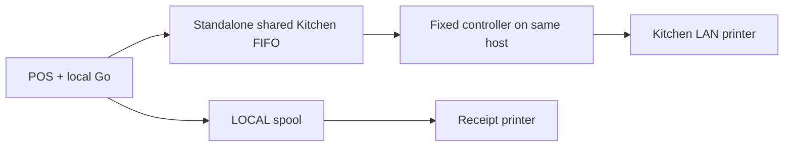
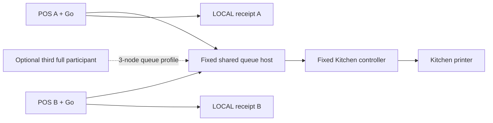
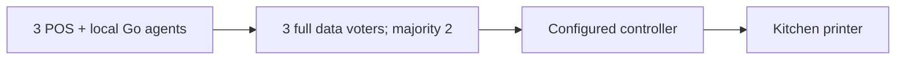
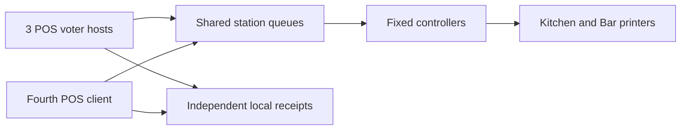
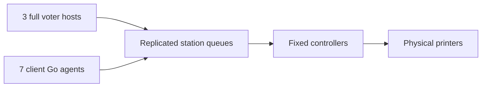
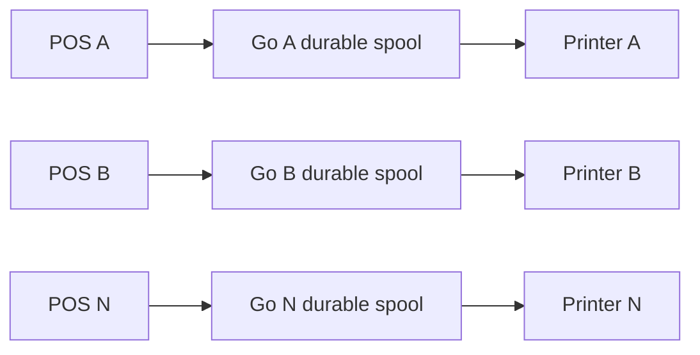
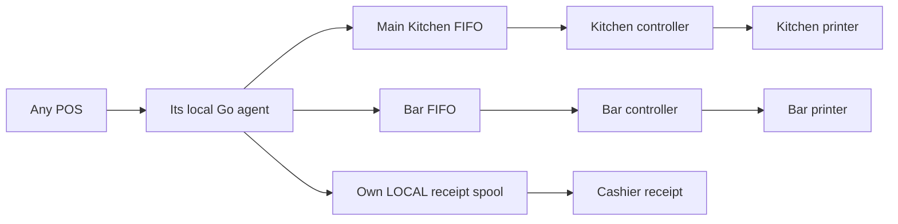
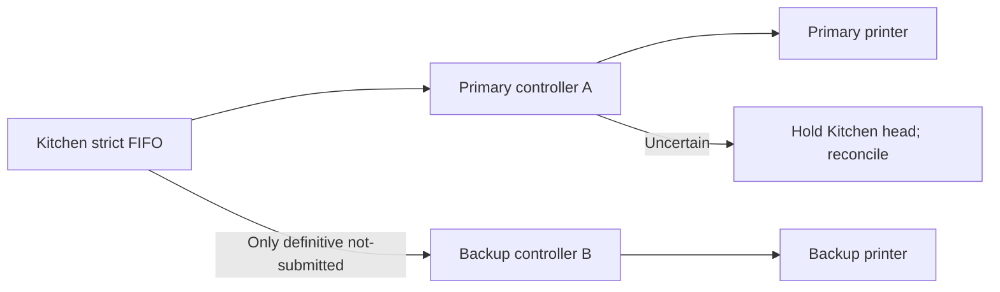
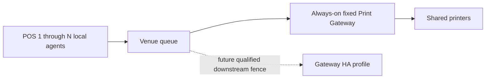

# Vynic printing architecture

Authoritative design, 2026-10-09. Implementation evidence and remaining gates are
tracked in `POS_PRINTER_ARCHITECTURE_REPORT_2026-10-09.md`. The October 6 report
and its sealed proofs describe the previous candidate and remain unchanged.

## Architecture delta

Preserve Flutter rendering, the authenticated local Go boundary, Windows service
host/helper, durable LOCAL spool, Hashicorp Raft/Bolt/SQLite replication, complete
immutable bytes, exact admission receipts and physical safety holds. Add a
station domain above those components. A business output names a station, never
a printer address, POS number, leader or Windows host. Separate a logical job
from each physical attempt. Assign physical routes to fixed controllers, not
elected queue leaders. Backup selection is a new attempt on a different printer
only after a definitive not-submitted outcome. Production activation is separate
from installing or testing this design.

## Invariants

- Station names and roles are configuration: Main Kitchen, Cold Kitchen, Bar,
  Upstairs Bar, Dessert, Expo, Cashier, Fiscal, or a custom station. A fiscal role
  grants no fiscal integration capability. KDS is an extension, not implemented.
- Scope is explicit: LOCAL belongs to one Device/Go installation; VENUE_SHARED
  accepts authorized sources in the Venue. Bar preparation is normally shared;
  cashier receipt is normally local. Either is configurable.
- Each physical printer has one canonical identity and one fixed controller.
  Multiple aliases, queues or addresses for the same hardware must be resolved
  during provisioning; textual endpoint uniqueness cannot prove hardware identity.
- Raft commits logical jobs, FIFO order, attempts and results. It cannot stop a
  paused process, retract buffered bytes, revoke a socket or fence RAW output.
- A persisted dispatch start precedes transport. Missing final result is
  UNCERTAIN. No automatic retry, backup, controller takeover or skip follows.
- Strict FIFO pauses the affected station behind uncertainty. Different stations
  progress independently unless they share a held physical printer.
- SUBMITTED means transport acceptance only. Paper delivery requires a separately
  qualified protocol or an explicitly labeled operator observation.

## Stable configuration and identity

A versioned Venue catalog contains stations, physical routes and controllers.
Each station has id, name, role, scope, optional local owner, enabled/sort order,
strict FIFO policy, and ordered route IDs (primary then optional backups).
Each route has physical identity, controller ID, transport destination, enabled
state and capability profile. Controller identity is a stable provisioned Go
installation/host mapping; Device and installation identities remain distinct.

A job retains job ID, Venue, station, source Device, business effect/reference,
creation time, immutable rendered bytes/digest and a configuration digest. Its
station output ID is deterministic from Venue + business effect + station +
output kind. Retries retain the same ID and bytes. Reprints use a new request/job
ID, original reference, authenticated actor, reason and time. Physical attempts
retain their own ID, number, printer, controller, timestamps and typed result.
Changing configuration never rewrites an admitted job or a historical attempt.

A complete Venue catalog can contain shared production and separate local
receipts. `Catalog.ForQueue` derives the shared snapshot or one Device's LOCAL
snapshot; each has its own digest. Business planning runs against the complete
catalog before splitting admission by scope. Queue snapshots omit business rules
so filtering cannot change a rule into a different implicit fallback. The issuer
must sign these explicit scope bindings; projecting JSON grants no authority.

Rendering compatibility is validated for every primary/backup. Initially all
routes of a station must accept the same frozen profile/bytes. A narrower paper
width or different printer language requires a future explicitly frozen render
variant; never regenerate old tickets from current Menu data during fallback.

## Failure policy

Connection failure with zero bytes and no submission entry can authorize the
next configured backup. Administrative disablement before an attempt can too.
A controller timeout does **not** prove non-submission after dispatch might have
begun. Only an authenticated, retained controller result that excludes submission
may authorize fallback. A controller unavailable before any dispatch reservation
may be skipped by a committed no-dispatch decision. This must not revoke a
reservation already issued to a delayed controller.

On uncertainty, reconciliation must establish that the original controller call
and downstream buffering are settled before releasing the physical hold. An
operator's assertion alone cannot fence a paused writer. A manual reprint does
not erase the original result. Backup printers on other controllers tolerate a
definitive primary failure; they do not repair ambiguous tickets automatically.

Physical ownership modes are NONE, FIXED_CONTROLLER and the reserved
QUALIFIED_FENCED_FAILOVER capability. No qualified fence exists today. The latter
must be refused, not silently degraded. A future QUALIFIED_FENCED_GATEWAY must
enforce ownership at the receiver and qualify recovery/status semantics.

## Topologies

Membership is proposed from stable provisioned hosts, then explicitly accepted.
Restaurant staff see stations, printers, primary/backup and host availability;
terms, epochs and voters belong in developer diagnostics. Never elect new voters
from discovery or silently reduce membership during an outage.

| POS sources | Default shared queue | Availability |
| --- | --- | --- |
| 1 | Standalone data node | No host failure tolerance |
| 2 | One fixed shared data host, or add a third full participant | Two machines alone do not provide 3-node HA |
| 3 | Three full data voters | Majority tolerates one voter loss |
| 4 | Three voters + one client | Client adds no quorum dependency |
| 10 | Three voters + seven clients | Same quorum as three sources |
| More | Normally three voters; explicit five-voter profile if needed | Five tolerates two voter losses |
| All LOCAL | Independent durable spools, no shared cluster | Each printer depends on its own host |

Queue availability and physical controller availability are separate in every
row. One always-on gateway is optional and remains one failure dependency.

### A — one POS

### B — two POS

### C — three POS

### D — four POS

### E — ten POS

### F — all LOCAL

### G — independent production stations and local receipts

Six POS can use two independent kitchen stations, Bar, Expo and any number of
local receipts. Khinkali routes to Main Kitchen and Beer to Bar from every POS.
An explicit item-to-Expo output gets a distinct deterministic station output ID.

### H — primary and backup

### I — optional gateway

## Product, provisioning and cutover

Waiters send orders without a printer picker. A small routing domain uses explicit
station overrides, then item, subcategory, category and Venue default mappings;
the source Device is considered only for explicit LOCAL ownership. Configuration
offers a Stations list and a Physical printers list with primary/backup ordering,
capabilities and configured controller. Saving a draft never tests a live printer.

Cloud owns Venue/Device authority and signs printer-purpose bindings. Edge pulls
them; Cloud never dials LAN. Local API uses pinned mutual TLS; shared RPC and
replication require authenticated Venue/installation identity, expiry and protected
revocation/high-water state. Discovery is a UX hint. Secrets are provisioned
separately from distributable profiles. Synthetic fixture identities grant no
production authority. The old proof stream stays separate; POS-02.B supplies the authenticated TCP/TLS transport.

Reuse the existing SCM executable, exclusive host lock, version/reader/helper
checks and retained shutdown. The existing held installer creates a stopped,
manual-start service; a qualified production installer must add automatic start
and bounded restart recovery. Those policies are not implemented by the current
plan-only installer. Flutter only connects; it
never starts a second service. Service-principal queue visibility, restart and
Windows boot need actual qualification. Foreground tests are not SCM evidence.

Cutover is route-scoped: freeze old admission; inventory and drain/reconcile all
legacy jobs and actual native calls; retain immutable receipts and held unresolved
rows; prove old writer exclusion; activate the new writer; verify; complete.
Rollback first fences/drains the Go writer and reconciles uncertain work. It never
requeues a SUBMITTED or ambiguous job in Hive. Old readers must refuse the new
schema/activation generation. Keep backups and the current production path until
this is proven. Shared printing does not enable multi-POS Order authority.

## Qualification

Keep software, actual Windows and physical evidence separate. Synthetic receivers
measure software submission/commit/dequeue/recovery, memory and disk growth only.
Power loss, network/cable pull, paper out, cutter, optional beep and physical backup
need named hardware/firmware and observed paper counts. Missing tests are NOT_RUN.
Exactly-once paper and same-RAW-printer automatic controller takeover are not
guaranteed. Production activation remains held until all applicable gates pass.

The station interfaces now have POS-02.B authenticated Go peer consumption; Flutter and physical activation remain held. Storage uses schema 2:
normalized transactional SQL rows for immutable jobs, configuration, station
sequences, receipts, attempts, results and reconciliation. A separate SQLite
content-addressed payload table retains digest/length/bytes under FULL/WAL
transactions. References prevent collection while retained rows need the bytes.
Corrupt payloads or normalized rows fail reopening explicitly. State transitions
copy mutable metadata and write changed rows; they do not encode/copy every
queued raster. Raft transfers bounded raw payload chunks and finalizes against
the exact job and payload identities. Once a payload is committed, later jobs
can reference it directly. Snapshots carry each blob once and retain a 64 MiB
budget. Every acceptance still waits for Raft majority commitment and durable
local application; initial membership and linearizable reads retain barriers.

Completed jobs, attempts, results, exact receipts, reconciliations and payloads
have a 30-day diagnostic retention policy measured from their final event.
Unresolved work has no expiry. A retained reprint pins its original, including
reprint chains. Explicit replicated compaction advances an admission time floor:
old exact submissions after collection are refused rather than recreated.
Sequences never reset. This is a bounded retry guarantee, not permanent
historical exactly-once delivery. Compaction is not yet scheduled by a production
runtime. The 128-job bound now applies to unresolved station jobs; completed
history is bounded by retention and the snapshot byte budget. Incomplete/rejected
requests remain capped at 256, active staging at 16 jobs/32 MiB, catalogs at 64,
and proof pinned membership at 16 (production signed inventory allows 256 identities). Capacity exhaustion fails closed. Raft retains three
snapshots and 32 trailing logs, with its existing 64-entry/20-second snapshot
policy; projection garbage collection never removes referenced history bytes.

Schema-1 stores are refused before changing their schema. Schema-2 commands and
the proof peer protocol exclude the old reader; snapshots are version 2. This is
not an automatic store migration or a production rolling-upgrade qualification.
Current storage results and outstanding integration work are in
`POS_PRINTER_PRODUCTION_INTEGRATION_REPORT_2026-10-09.md`.

The local authenticated RPC still admits no jobs; the station queue API is a Go
component interface, not a shipped Flutter-to-service submission path. The fixed
controller dispatcher refuses real transports. Controller durable receipts/drain, operator reconciliation, Flutter admission,
Hive migration/cutover and automatic SCM recovery remain implementation gates.
POS-02.B now supplies authenticated LAN and signed-configuration consumption. This report therefore cannot claim that missing hardware
qualification is the only remaining work.

POS-02.A now implements production-purpose issuance and verification separately
from activation: Device-authorized Go enrollment, server-owned stable membership
and signed catalogs, Windows-protected identity, persistent grant/revocation
high-water and TLS 1.3 peer authorization. Grants support seven days of cached
offline authority; a peer learns revocation on refresh, or authority expires.
See `POS02_A_PROVISIONING.md`. POS-02.B connects this authority to actual peer
RPC/Raft and the existing durable queues. Only explicit first-configuration
initialization bootstraps; identity-bound queue markers refuse lost-store
replacement. Signed 1-to-3 voter expansion resumes from the existing log;
removal/replacement/address movement remain held. Endpoint-less clients can open
their first listener when a signed voter assignment supplies an endpoint. See
`POS02_B_PEER_TRANSPORT.md`. Next is POS-02.C; automatic Cloud renewal, service
lifecycle and physical activation remain later gates. Overall POS-02 is NOT_DONE.
