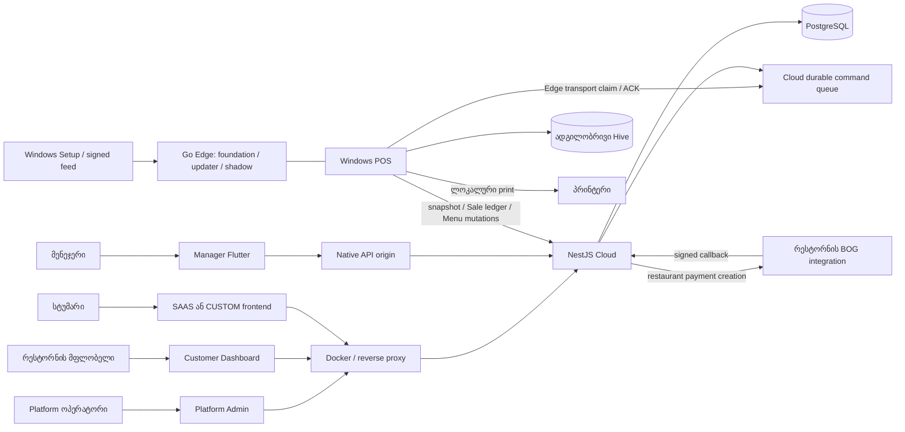

# სისტემა, ავტორიტეტები და სამუშაო გზები

ჭრილი: 2026-09-29; `f7bb982` + საწყისი WIP. ქვემოთ მომავალი არქიტექტურა მიმდინარე შესაძლებლობად არ არის წარმოდგენილი. მთავარი დასკვნა: Vynic არის **ერთი Cloud backend და რამდენიმე კლიენტი**, სადაც რესტორნის ცოცხალ ოპერაციებს ჯერ **ერთი ძირითადი POS-ის Hive** ფლობს. Menu-ის ახალი canonical პროტოკოლი ცალკე დომენია და მრავალ ოპერაციულ მოლარეს არ ქმნის.

## სისტემის რუკა



აქ `Edge transport` არის Device-ით ავტორიზებული Cloud pull/ACK გზა, რომლის production handlers POS-შია. `apps/edge` Go პროცესის foundation, updater და Phase 2A shadow შემოწმებები **არ უდრის** ყველა live Order/Table ბრძანების Go-ზე გადატანას. Cloud-იდან LAN-ზე ახალი გამოძახება არ არის რეკომენდებული; legacy fallback მხოლოდ zero-Device compatibility-ა.

## ვინ რას იყენებს და სად წერს

| ნაწილი | ვინ / რა ამოცანა | კითხულობს / წერს | უფლება და offline |
|---|---|---|---|
| Platform Admin | Vynic ოპერატორი: customers, plan, capabilities, domain, primary Device, support audit | Cloud/PostgreSQL control plane | ცალკე `PlatformUser`, `SUPER_ADMIN`/`SUPPORT_READONLY`; არ არის Staff; offline არა |
| Customer Dashboard | owner: რესტორნის identity/Menu/საიტი, მოწყობილობა/Manager setup, subscription | membership-სკოპიანი Cloud მონაცემები; presentation draft და explicit publish | `CustomerAccount → OrganizationMembership → Venue`; product gates დამატებით; offline არა |
| Windows POS | მოლარე/მიმტანი: tables/orders/lines/close/print/day | Hive authoritative operation; Cloud catalog projection+journal; asynchronous mirrors | ადგილობრივი Staff/PIN; Device→Venue Cloud-ზე; წარმატებული initial setup-ის შემდეგ offline core |
| Manager | მფლობელი/მენეჯერი: Cloud მონიტორინგი, inventory/finance, remote requests | Cloud mirrors, Cloud-owned inventory/payroll; ზოგი operational command POS ACK-ს ელოდება | Staff→Venue + MANAGER_APP + module + action role; cache არის stale read, არა offline Cloud writer |
| NestJS Cloud | ყველა კლიენტის shared service, auth, entitlement, queue, payment callback | PostgreSQL; media storage; durable dispatch | identity boundaries backend-ში; outage-ისას POS local უნდა გაგრძელდეს |
| PostgreSQL | shared `pos`/`website` schemas, ყველა Venue-ს Cloud state | operational mirror, canonical Menu, accounts, inventory, payment config, subscriptions, audit | Venue არის tenant; client `venueId` ავტორიტეტი არაა |
| Hive | POS-ის local orders/sales/tables/users/settings/journals | POS უშუალოდ წერს | სხვა terminal-ის Hive-ს ავტომატურად არ რეპლიცირებს |
| Go Edge | ლოკალური host/updater/pairing და shadow coordination | საკუთარ journal/state store-ს | production operational cutover გამორთულია |
| SaaS restaurant website | სტუმარი; ერთი მრავალ-Venue build | Host-ით public menu/profile/published presentation | WEBSITE + capability + publication/readiness; generic frontend-ის შესაძლებლობები შეზღუდულია |
| CUSTOM website | კონკრეტული ბრენდის სტუმარი | იგივე backend, ცალკე frontend | Host→VenueDomain; `siteKey` deployment identity-ა, tenant authority არა |
| installer/updater | operator / ადგილზე მომხმარებელი | signed Edge/POS bundles, staged install, health/rollback | explicit install/update; Windows qualification ცალკეა; signing code ≠ production certificate |
| Docker/proxy | deployer | აგებს frontend/backend image-ებს; Host/path routes, persistent media/DB | production TLS/manual infrastructure; local native LAN opt-in |

საყრდენი კოდი: `apps/backend/src/app.module.ts:45`, `apps/backend/src/customer/customer-auth.ts:82`, `apps/backend/src/website/tenancy/website-tenant.service.ts:62`, `apps/backend/src/edge/edge-device.guard.ts:10`, `apps/operations/lib/main_pos.dart`, `apps/operations/lib/main_manager.dart`. დეტალური POS execution paths: [POS_MENU_EDGE.md](POS_MENU_EDGE.md); Manager metrics: [INVENTORY_MANAGER_UX.md](INVENTORY_MANAGER_UX.md).

## მონაცემის ავტორიტეტები

| დომენი | მიმდინარე writer | მთავარი საფრთხე |
|---|---|---|
| Plan/subscription/domain/primary | Platform + განსაზღვრული owner lifecycle requests | ownership არ ანიჭებს paid rights-ს; არ აურიოთ plan და operational policy |
| Canonical Menu ახალ Venue-ში | owner Cloud mutations და ნებისმიერი enrolled POS; per-entity revision | journal/projection/crash და exact retry დეფექტები; primary შეზღუდვა Menu writer-ს არ ეხება |
| Legacy Menu | POS snapshot compatibility | explicit cutover-ის გარეშე canonical-ზე არ გადადის |
| Table/Order/payment/day | primary POS Hive | Cloud mirror-ს direct edit შეუძლია ავტორიტეტის დარღვევა; MGR-02/05 |
| Stock/receipt/supplier debt | Cloud quantity/value ledger | recipe snapshot-ს უნდა გადაურჩეს deletion; locations/waste/count აკლია |
| Sale | POS frozen record; Cloud mirror idempotent | captured prices/history არ გადაითვლება ახალი Menu-ით |
| payroll/obligation | Cloud frozen periods + append-only accrual/payment | payment correction workflow აკლია |
| Website public data | shared Venue profile/Menu/public info; presentation published snapshot | draft→live migration და Vankisi hardcoded bypass |
| Website payment | server reservation + encrypted merchant revision + signed provider outcome | alternate untrusted amount, callback ordering და dispatch gap |

## ექვსი რეალური გზა

**A. მოთხოვნა → დამტკიცება → მოწვევა → dashboard.** `apps/platform-web/src/customer/AccessRequest.tsx` აგზავნის Customer access request-ს; `apps/backend/src/customer/owner-invitations.service.ts` ამუშავებს operator approval-ს, safe Organization/Venue shell-ს და ერთჯერად მოწვევას. TRIAL პროდუქტები, ვადა და WEBSITE-ის შემთხვევაში SAAS/CUSTOM აშკარად ირჩევა; default NO_PLAN. `owner-invitations.service.ts:299` token acceptance membership-ს ქმნის. ანგარიშის არსებობა არც trial-სა და არც პროდუქტის ჩართვას არ ნიშნავს. Public `DemoForm.tsx:39` **სხვა ფორმაა**: მხოლოდ 700ms timeout-ით success-ს აჩვენებს და მოთხოვნას არ ინახავს — UX-01.

**B. Website-only → Menu → publish.** operator `provisionWebsite` (`website/provisioning/website-provisioning.ts:48`) ანიჭებს mode-ს და ცარიელი Venue-ს Cloud authority-ს. owner editor `restaurant-foundation.service.ts:38` → `MenuCatalogService` წერს ერთ catalog-ს; public info საერთო Venue row-შია; SaaS presentation draft მხოლოდ explicit publish-ის შემდეგ არის public. Host-ზე `VenueDomain` resolves venue-ს; generic renderer კითხულობს bootstrap/Menu-ს. Media TRIAL-ზე გამორთულია. Cloud authority-ს admission და content publication სხვადასხვა წესია; WEB-02 ამ საზღვარს ისტორიულ migration-ში არღვევს.

**C. POS → enrollment → Menu → order → settlement → close.** Device enrollment ერთჯერადი code-ით ქმნის Device credential-ს (`edge/device-enrollment.service.ts`, POS `edge/pos_enrollment_service.dart`); პირველად არჩეული primary transactionally დგინდება. POS credential Hive-ს გარეთ `edge_device.json`-შია. canonical bootstrap მოაქვს catalog; ადგილობრივი edits ინახება projection+journal გზით, სადაც MENU-01/02 remediation საჭიროა. `order_repository.dart` ქმნის ადგილობრივ Order/Table კავშირს; `close_table_transaction.dart` closure ID/journal/Sale boundary-ს იყენებს; capture tender უცვლელი financial snapshot-ია. Cash/card/split არჩევა ადგილზე თანხის აღრიცხვაა, bank authorization არა. Close Day ცალკე path-ია და დღეს საკუთარი durable transaction-ის გარანტია არ აქვს.

**D. Manager login → restaurant data → action.** `main_manager.dart` ცალკე startup-ს იყენებს. პირველად restaurant code, შემდეგ PIN; `/auth/manager-venue`, `/auth/mobile-login`; request-ზე Staff აქტიურობა და Venue/feature ხელახლა მოწმდება. read `/mobile/dashboard`, `/mobile/tables`, ledger reports. inventory/payroll write Cloud transaction-ია; operational write უნდა გახდეს durable command და დასრულდეს POS ACK-ით. მიმდინარე `freeTable` მხოლოდ Cloud-ს ცვლის და ზოგი UI `posDelivery`-ს უგულებელყოფს. [Inventory/Manager trace](INVENTORY_MANAGER_UX.md) თითო რიცხვის stored source-სა და სიძველეს აჩვენებს.

**E. CUSTOM frontend → domain → backend.** operator selects CUSTOM, active `VenueDomain`, binding `siteKey`; deployer აგებს/ათავსებს კონკრეტულ frontend-ს და აწყობს Host-preserving `/api` proxy-ს. public request-ის Host-ს backend resolves server-side; frontend-ის client Venue ID უფლებას არ ქმნის. Vankisi standalone-ა; optional `packages/website-client`/`templates/custom-site` ახალ პროექტებს შეიძლება გამოადგეს, მაგრამ Vankisi-ის გადაყვანა საჭირო არ არის. READY/ACTIVE არის operator attestation; build-ის სისწორეს დღეს name-only runtime check ვერ ამტკიცებს.

**F. Menu edit → durable mutation → სხვები.** owner Cloud mutation პირდაპირ revision-ს ამოწმებს; POS local edit ჯერ Hive-ში მუშაობს, შემდეგ UUID mutation journal-ით იგზავნება. Cloud იღებს `(venueId, mutationId)`-ს, payload hash-ს, per-node revision-სა და change sequence-ს; სხვა clients catch-up-ით პროექციას აახლებენ. legacy Venue snapshot path ცალკეა. offline POS A და B ახალ OrderLine-ს თავიანთი მიმდინარე ადგილობრივი projection-ის ფასით ქმნიან; conflict-ის გადაწყვეტამდე ფასები შეიძლება განსხვავდებოდეს. უკვე გახსნილ/ისტორიულ ხაზზე დაფიქსირებული ფასი live Menu ცვლილებით არ იცვლება. ეს ხელმისაწვდომობაა, არა ერთდროული ფასწარმოქმნის გლობალური გარანტია.

## SAAS/CUSTOM binding-ის შემცირებული ნაბიჯები

ახალი SaaS-ისათვის დღეს დაახლოებით **5 business ეტაპია**: მოთხოვნა/owner შექმნა → operator plan+trial/active+SAAS არჩევანი → invite acceptance → menu/profile/presentation → preview/publish. უკვე owner-ის მქონე Venue-ზე 3 ეტაპამდე მცირდება. hostname ავტომატურად ენიჭება; სახელის შეცვლაზე hostname ჩუმად არ უნდა იცვლებოდეს.

CUSTOM-ს დამატებით აქვს რეალური frontend build/deploy, siteKey, domain, renderer service/router, DNS/TLS და flow verification. მიმდინარე proxy-ს ერთი CUSTOM_HOST ერთ Vankisi service-ზე გადააქვს; მეორე custom frontend **მხოლოდ DB-ში ACTIVE მონიშვნით ვერ გაჩნდება** (`deploy/traefik/routes.yml:108`, `compose.yaml:70`). საჭიროა frontend/build/service/router კონფიგურაცია და გარე domain/TLS ოპერაცია. local origin-ის port runtime config-ია, domain identity-ში არ ინახება.

შემოთავაზება: operator-ის ერთი review გვერდი ხუთი დამოუკიდებელი ფაქტით — **პაკეტი**, **ინტერფეისის ტიპი**, **დომენი**, **განთავსებული ვერსია**, **გამოქვეყნება**. მომხმარებელი ხედავდეს მხოლოდ გასაკეთებელ სამუშაოს. Runtime result ცალ-ცალკე ამბობდეს „frontend პასუხობს“, „სწორი build“, „სწორი backend Venue“, „ბიზნესფუნქცია მზადაა“. public info-ის ცვლილებაზე live შედეგი წინასწარ უნდა იყოს განმარტებული; private presentation draft ცალკე დარჩეს. ეს workflow proposal-ია, არა განხორციელებული redesign.

## მიმდინარე საქაღალდეები

```text
apps/
  backend/               NestJS + Prisma, modular monolith
  platform-web/          public Vynic + Customer + Platform Admin
  restaurant-web/        generic SAAS renderer
  vankisi-custom-web/    standalone customer frontend
  operations/            shared Flutter code, explicit POS/Manager entrypoints
  edge/                  Go foundation/shadow/updater/Setup
  devtool/               desktop developer tool; restaurant product არაა
packages/
  contracts/             source schema + generated TS/Dart/Go contracts
  website-client/        optional frontend library; app არაა
templates/custom-site/   starter; deployed customer site არაა
deploy/                  frontend Dockerfile, nginx, Traefik
scripts/                 local Docker/setup/proof/destructive tooling guards
docs/                    state, decisions, runbooks, audits
.agents/skills/          pinned project skills
.claude/skills/          symlinks
```

## შემოთავაზებული პასუხისმგებლობები — არა folder rewrite

ამ milestone-ში არც ერთი ფაილის გადაადგილება არ ხდება. იგივე apps/packages/template roots უნდა დარჩეს. ქვემოთ ცვლილებები მხოლოდ შესაბამის bug-fix-ის გამარტივების მიზნითაა; microservices/framework/package შეცვლა არ არის რეკომენდებული.

| შესაძლო გამოყოფა | რა პრობლემას წყვეტს | რა იცვლება / ახლა საჭიროა? | დამცავი proof |
|---|---|---|---|
| `backend/src/website`-ში shared booking+pricing application service | ორი creation path სხვადასხვა trusted amount-ს იყენებს | controller imports/DI; URL უცვლელი ან აშკარად deprecated; **ახლა SEC-01-ისათვის** | ორივე route-ის tamper/permission tests |
| operational command application boundary | Cloud mirror write და POS authority ერთმანეთშია | mobile service→existing `PosCommandModule`; Cloud→LAN არ ემატება; **MGR fixes-ისას** | queued/rejected/ACK/retry/no partial mirror |
| Flutter local mutation coordinator + journal APIs | Menu/direct writers, transfer/day barriers განცალკევებულია | repository/transaction callsites და startup recovery; native build roots უცვლელი; **P0 fixes-ისას** | ყველა writer interleaving + crash recovery |
| inventory domain documents vs screens | giant screen და სხვადასხვა ledger მიზანი იკარგება | feature-specific screen/viewmodel extraction მხოლოდ UX ეტაპზე; persisted IDs უცვლელი | flour journey + permission/widget regression |
| optional `FinanceModule`/`MobileModule` | `AppModule` ბევრი service-ის პირდაპირი composer-ია | DI imports/providers, circular dependency risk; **ახლა არა**, თუ implementation არ ითხოვს | Nest boot + existing service/API suites |
| typed API response envelope | `any`, success/queued/stale semantics არაერთგვაროვანია | shared DTO/types ახლანდელ packages-ში ან app-local; build paths უცვლელი | runtime validation + compatibility contract tests |

`apps/backend/tsconfig.json`-ში `noImplicitAny:false`; Customer API-ს default `T=any` აქვს (`apps/platform-web/src/customer/api.ts:20`). მიმდინარე lint debt რეალურია, მაგრამ ათასობით warning-ის მასობრივი ავტომატური შესწორება security milestone-ს არ უნდა შეერიოს. მცირედ გაამკაცრეთ არჩეული boundaries და დაიცავით wire compatibility.

დუბლირებული წესების მაგალითებია booking-ის ფასის დათვლის ორი path, local/remote operation completion-ის განსხვავებული განმარტება და generic backend-ში კონკრეტული 9+4 table filter. თითოეული უნდა გამოსწორდეს თავის root-cause task-ში. ყველა import cycle-ის ან orphan-ის სრული AST proof არ შესრულებულა; აუდიტი არ აცხადებს, რომ ასეთი პრობლემა საერთოდ არ არსებობს. არსებული shared contracts check გაიარა. Skill trust-ისათვის pinned `.agents/skill-sources.txt` და symlinks არსებობს; არც skill განახლებულა და არც upstream script გაშვებულა.
