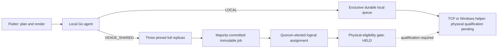

# Printer implementation and verification

Status: **NOT_DONE / production admission and physical activation held**. Base commit
`275688e1e5c5dc0e26e62705ab0c7670cf16d99a`, branch
`codex/docker-deployment-foundation`. This report covers printer work only.
The next general stabilization milestones are not being started.

## How it works

The selected boundary keeps Flutter's business planning, Georgian raster
rendering, printer configuration and operator journal. The migration target is
one independent Go service per Windows computer; Flutter sends immutable work
to its local service. Go owns durable admission, queue ordering, background
lifecycle and the native transport helper. Closing a Flutter window must not
create or terminate the printer writer.

`LOCAL` and `VENUE_SHARED` are explicit authority scopes independent of transport.
LOCAL has an exclusive local durable spool and no cluster-quorum dependency.
Shared work uses stable provisioned membership and complete data-bearing
replicas. Three full voters commit with two; a fourth POS is a client. Two POS
need a third full participant for single-voter failure tolerance. No discovery
or outage silently converts shared work to LOCAL or promotes a client.

The existing production Flutter/Hive transport remains active until a compatible,
separately qualified cutover. The isolated business postimage proof API and the
new local printer API have separate contracts. The latter provides authenticated
health and explicit held submission/query results. No held response is an
ACCEPTED receipt or a usable production print writer. No SCM service was installed.

## Implemented boundaries

- Fixed-host/local executor: SQLite WAL with full synchronization, immutable
  admission and lost-ACK receipts, one durable FIFO per physical printer,
  independent printer progress, and start-before-call persistence. A stopped or
  uncertain printer does not block durable admission or another printer.
- Interrupted primary output becomes `UNCERTAIN` and is never automatically
  replayed. A deliberate reprint has a new identity and operator audit.
  `SUBMITTED` means bytes were accepted by the transport, not confirmed paper.
- Optional sound has a separate durably spent reservation after primary
  acceptance. The original signal call retains exclusivity until it settles.
  Unknown/malformed optional sound is disabled without rejecting primary output.
- Dart freezes actual transmission bytes, capability profile and exact retained
  configuration digest. Version 1 pins a fixed host; version 2 keeps election,
  attempt and executor metadata in a separate logical claim. Jobs are not
  rewritten when leadership changes.
- Generated protocol bridge: pinned mutual TLS identity, signed immutable
  terminal/origin enrollment, transaction-current credentials, and atomic
  business-result/effect/queue/receipt persistence in the isolated gateway store.
  No production enrollment or new live credentials were created.
- Windows transport: synchronous Go transport, single TCP write without retry,
  typed outcomes, bounded native protocol, pinned helper binary and shared
  Flutter-independent Winspool core. Atomic Job Object containment precedes
  helper execution; printer ownership survives public deadlines until the actual
  child exits. Termination cannot retract already spooled bytes.
- Host lifecycle: pinned identity/schema/protocol/helper health, admission fence,
  retained primary/beep drain, resource closure before ownership release, and
  Windows stop-pending/stopped status propagation. Ordinary caller cancellation
  does not stop a healthy host; actual pin/storage failure does.
- Runnable agent: explicit foreground, Windows service and validation entrypoints;
  strict held configuration; a dedicated pre-existing state directory; current
  executable/helper/profile checks; exclusive host ownership; and authenticated
  loopback health. Startup and exit failures use the same retained drain. No
  default Edge/Hive directory, enrollment secret or physical scheduler is opened.
- Local API: TLS 1.3 with exact current client certificate and host/client URI
  pins, immutable strict submission bytes, fresh certificate validity checks,
  bounded retained shutdown and explicit provisioning/physical holds. The Dart
  client pins the exact server leaf and closes its connection after status reads.
- Status UI: an explicitly configured, manually refreshed card in the developer
  printer panel. Current Device/restore context and pinned profile assets must
  match before and after a read; changing context discards the old result. The
  default build has no profile, automatic agent start or print submission.
- Provisioning validation: a printer-only signed candidate binds explicit
  Device, Venue, Go installation, host, origin, terminal, client leaf, authority
  generation, LOCAL/shared membership, physical printer alias and complete
  retained route/configuration bytes. Each validation reads separately trusted
  current state. Temporary test keys establish validation behavior only; this
  package issues no production grant and persists no revocation/high-water state.
- Installer source: a reviewable plan and an explicit Windows apply boundary.
  An approved principal and qualification receipt, exact configuration/artifact
  hashes and unchanged current service state are required. Plan-only tests do
  not register a service. No account, ACL, logon-right, firewall, driver, trust
  or credential changes are automatic.

The replicated queue uses Hashicorp Raft and Bolt log/stable storage with a
full-synchronization SQLite projection. Complete bytes/configuration are staged
in bounded chunks; ACCEPTED requires a majority-committed complete finalize.
Logical assignments are leader-only in this candidate. A USB owner mismatch
holds dispatch; arbitrary follower-executor transfer is not implemented.
Actual process tests replicate a 600 KiB payload on three voters and a fourth
client; separate in-process three-voter tests use 700 KiB. The 8 MiB maximum
primary-payload/snapshot test uses one voter and does not prove 8 MiB majority
throughput. These tests do not grant physical RAW failover.

## Why shared RAW dispatch is held

Consensus decides committed order and leadership. A RAW printer does not enforce
that leadership term. A real loopback counterexample pauses the old writer after
its last valid lease check, lets the new writer send, then resumes the old write.
The receiver observes reversed order. Another test demonstrates buffered bytes
arriving after socket close. Short leases, stable IDs and another final check do
not remove arbitrary process pauses or buffered bytes.

The logical gate can validate current majority evidence. Its physical check
always refuses dispatch pending a qualified downstream fence. This expected
unsafe counterexample is a **failed physical guarantee**, not an HA success.
No source or simulation establishes exactly-once paper output.

Actual models/firmware and an independent always-on host are still unconfirmed.
A separately chosen gateway can remove dependence on any POS while remaining
a gateway failure dependency. Model-qualified printer queues or an enforceable
network/receiver fence need explicit selection and qualification. IPP or ESC/POS
compatibility alone is insufficient. USB remains dependent on its attached host.

## Verification boundaries

Final exact source hashes, commands, logs, review receipts and the requested
18-case passed/failed/not-run matrix are in
`docs/proofs/POS_SHARED_PRINT_GO_275688e1_2026-10-06/`.
Earlier sealed Windows and multi-terminal proofs remain separate and unchanged.
Results from a clean exported candidate do not claim an exact committed runtime.

The continuation freezes one combined 1,109-file source cohort, with 39 Flutter
suites and 68 analysis targets. Its new daemon/CLI/installer and combined Windows
execution are **NOT_RUN_BLOCKED**: automatic approval review rejected the
current-user VM preflight, citing the original VM hold and declining retained
handoff evidence of the later user clearance. No alternate executor was used.
The exact target is Windows VM `9830bac8-34c6-46f7-9062-cd8f62f7a127` through
`prlctl exec --current-user`; only isolated synthetic tests/builds are proposed.
Earlier Windows receipts below qualify their separately pinned source, not the
new combined runtime. Source-only staging and cross-compilation do not close
this execution requirement.

Available combined checks pass with all 1,109 source hashes unchanged in both
the candidate and verification copy. Normal and race Go runs each pass 225
top-level tests and 764 records including subtests; nine fixture entrypoints
skip standalone invocation and are exercised by their parent process/wire tests.
The actual normal/race foreground binaries are bound to this same source and
retain their before/after hashes. Flutter passes 623 visible tests plus 51 hidden
loader/setup records in 39 suites, with zero skips/errors; all 68 analysis
targets are clean. Both real Go mutual TLS fixtures are present. The initial
Flutter wrapper/parser failure and its subsequent total-versus-visible count
error remain identified as history; the final normalized receipt uses
`testDone.hidden` and records the actual successful process exit.

Go vet, generated-contract compilation and Windows amd64/ARM64 source builds
pass. Official Go vulnerability scans report zero findings for the loaded
macOS/Windows source graphs and generated-contract module graph; this is not a
project-wide security claim. Independent source, lifecycle, protocol, native,
provisioning, UI and packaging reviews have no remaining P1/P2 findings.
The two four-file Windows bundles reproduce byte-for-byte with matching
qualified helpers, contain no credentials, and are explicitly unprovisioned.
Their descriptors do not establish a runnable production installation.

The final 18-case matrix records 17 passing bounded software counterparts and
one not-run machine-disappearance counterpart. Case 18's actual macOS foreground
restart is bounded evidence; installed SCM/Windows restart is still not run.
All 18 full physical acceptance cases remain not run.

The earlier frozen Go source export contains 163 pinned inputs. Its broad normal and
race runs each pass 504 records including subtests, with seven explicitly
skipped child-fixture entrypoints. The skipped entrypoints are exercised by
their parent process tests rather than invoked as ordinary standalone cases.
The race run includes the three-process leader kill/rejoin and 8 MiB single-voter
snapshot recovery. The earlier broad race failure is retained: its readiness
fixture allowed 400 ms while restoring the large state. An idle diagnostic
reproduced the timeout with the node still leader; the test-only fix keeps
committed readiness and all exact-state assertions with bounded longer waits.
No production consensus policy was changed to make the test pass.

The earlier frozen Flutter candidate passes 535 tests in 36 selected suites, with
clean analysis of 59 files and no skipped tests. It includes the real synthetic
Dart-to-Go mutual TLS fixture rather than substituting a mock transport.
The same selection also passes on Windows: 535 visible tests in 36 suites,
including all 19 wire tests, and clean 59-file analysis. The test wrapper's
analysis launch failed because its batch launcher required unavailable Git;
the successful test log is retained and separate analysis using the existing
native Dart executable completes with all 898 source hashes unchanged. The
failed wrapper's nested-array selector counts are not used as evidence.

The Windows helper packet contains 34 pinned source inputs and a pinned Go test
executable. After the user started the suspended guest, its corrected version 2
passes 12 Go tests plus 26 subtests without skips, 254 fake-protocol assertions,
110 fake-core assertions and 204 actual read-only channel assertions. Kernel
tests observe parent death, exact child termination and fresh semaphore
acquisition. All source and 43 cached SDK hashes remain unchanged; print jobs
remain zero before and after. The failed test-only MSVC fixture version is
preserved separately. Those executables are amd64 on a Windows ARM64 guest.
The matching native ARM64 helper is now separately qualified: 12 Go tests plus
26 subtests, 254 protocol assertions and 110 core assertions pass under the
current Windows user, with zero skips or documents. Its 291,328-byte PE ARM64
artifact imports only Winspool and Kernel32. All 34 source and 2,984 cached
compiler/SDK inputs retain their before/after hashes. The earlier invocation
under the VM tool's default SYSTEM context is preserved and identified as such;
the new current-user run is not qualification of the future service principal.
The real service principal/SCM and physical output remain unqualified.

The official `tool/product.py` POS preparation also produces a successful
Windows amd64 Release build from 898 derived source files, with all source and
182 cached Firebase SDK file hashes unchanged. Its 23 artifacts match their
hash manifest; `vynic_pos.exe` is packaged with portable forward-slash ZIP
entries. The build is a development/local-lab candidate, not a signed release,
installed product or startup smoke test. An earlier generic build linked the
Manager-default binary name and failed the wrapper's expected POS artifact;
that attempt is retained separately rather than counted as POS success.

Additional actual TCP crash checks pass on macOS with a literal loopback
receiver. One records Write entry with no observed return marker at SIGKILL;
the exact 8,192-byte prefix drained after death is shorter than the 2 MiB frozen
payload. The marker cannot locate an instruction-exact syscall state. Another
receives all immutable bytes, including the cut, and observes `SUBMITTED` before
the process is killed ahead of queue disposition. Both retain one attempt and
the same receipt, recover as `UNCERTAIN`, and make zero replay calls. Neither
observes paper delivery.

All 18 full physical acceptance cases remain not run. The two RAW
counterexamples are observed failures of the proposed physical guarantee.
Passing process and synthetic transport tests do not change those statuses.

## Remaining implementation, decisions and permissions

Production admission has software dependencies in addition to the physical
printer gate. Current Cloud Device credentials are opaque online credentials;
ordinary enrollment JSON is not an offline signed printer grant. The existing
Foundation bootstrap purpose is `FOUNDATION_ONLY`, and the operational fixtures
are `ISOLATED_PROOF`. Neither is converted into production printer authority.
Cloud runtime configuration responses also do not supply the complete signed
offline device/origin/terminal/route registration required by this candidate.

The remaining implementation is a server-owned production issuer/enrollment
bridge, protected current authorization and revocation/high-water storage,
authoritative active physical-route registration, and their attachment to the
agent's held validation seam. The policy must explicitly map the distinct
Device and Go installation identities (D019), define offline grant lifetime and
revocation behavior, and define route/alias activation and reconciliation.
Those components are not implemented by supplying an unsigned profile or by
letting a client populate the validator's trusted-state object.

The shared service runtime also remains an implementation dependency. The
qualified Raft package uses isolated loopback/test transports. The held daemon
does not start a production authenticated LAN cluster, provision/bootstrap its
stable members, relay normal POS submissions or attach committed logical claims
to a qualified physical dispatcher. A `VENUE_SHARED_HELD` health profile is not
evidence that a three-voter deployment is running. The installer currently plans
the held LOCAL profile; an installed production shared-voter profile still needs
the explicit membership, authority and activation implementation.

Finally, normal business planners and every production printer writer still
need the real immutable admission/receipt bridge, unresolved Hive-job migration,
operator reconciliation and labeled reprint attachment, reader floors and
upgrade/rollback qualification. The tested detached planners, queue primitives
and held RPC are reusable boundaries; they do not implement that cutover.

The user still needs to select the supported models/firmware and either a
qualified downstream fence or an independently powered gateway availability
profile. The exact Windows service principal and its queue/access qualification
also remain to be selected. These are separate from source changes that can be
tested using synthetic identities.

Future permission requests must name concrete targets: the selected production
issuer's signing-key custody/configuration, the selected agent's protected
credential/state paths and access policy, and registration of the exact
`VynicPrinterHost-<selectedHostUUID>` service/binary/configuration under the
approved principal, using the exact name and digests in its reviewed plan.
No such real key, service account or live printer route was created in this task.

## Remaining acceptance and cutover requirements

1. Select and physically qualify the actual printer models, installed drivers,
   service-account queue visibility, Georgian raster, cutter and optional sound.
2. Qualify paper/cable/power/process-interruption behavior and the explicit owner
   reconciliation policy. Do not silently skip or resend an uncertain FIFO head.
3. Resolve downstream physical fencing for shared LAN printing, or explicitly
   select the independently powered fixed gateway availability profile.
4. Qualify installed SCM startup under the exact approved principal,
   bundle/helper identity, forced shutdown and Windows restart.
   Installation/account/ACL/firewall/trust/driver changes remain unperformed.
5. Attach and fence every production writer during cutover, preserve/import
   unresolved Hive jobs, qualify schema/reader floors, upgrades and rollback,
   and attach the remaining business planners/command paths. Current detached
   adapters do not establish complete production writer coverage.

No push, deployment, merge, service registration, driver installation or local
commit is implied. The conditional commit requirement is not met while POS-02
and the physical activation gates are incomplete.
